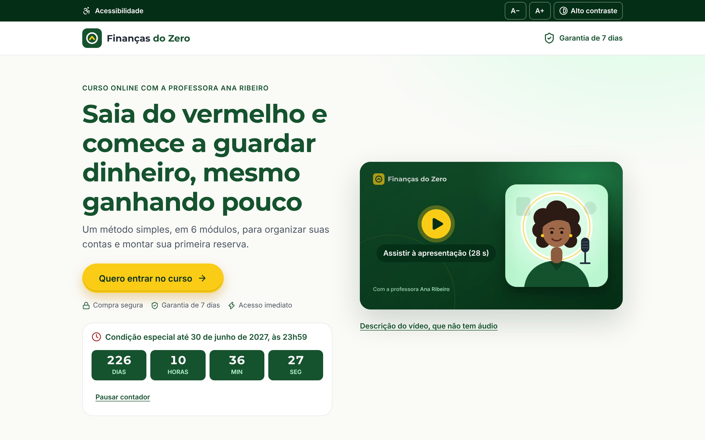
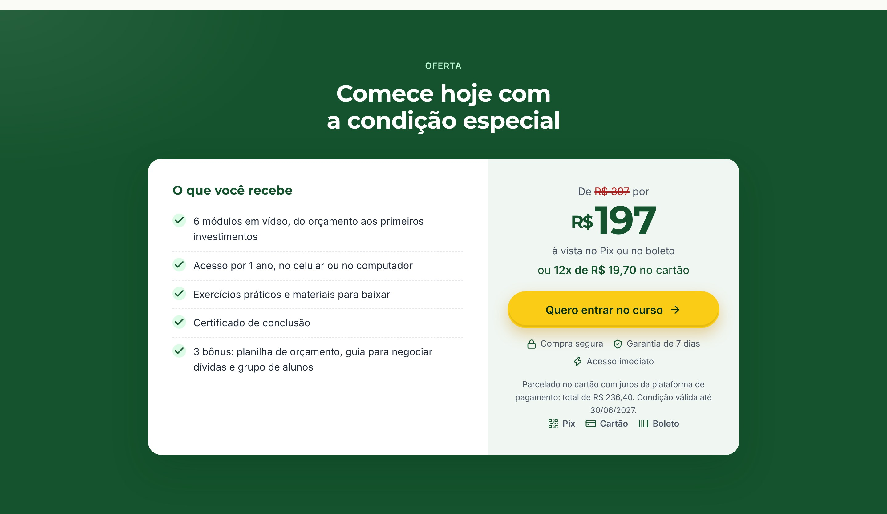
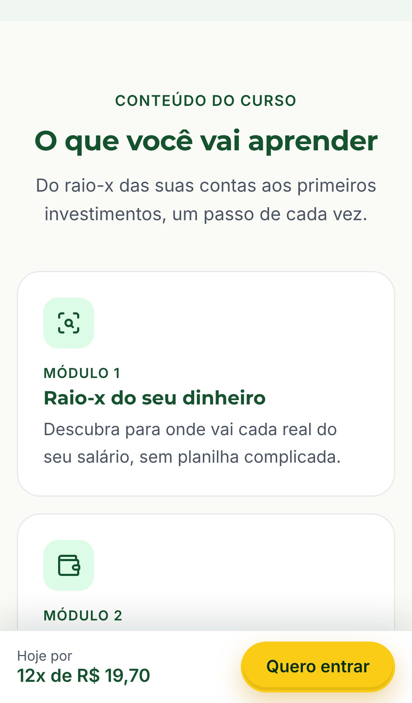

# Curso Finanças do Zero · Landing page de vendas

> **Projeto conceitual de portfólio.** O curso, a professora Ana Ribeiro, os preços, o CNPJ e os depoimentos são fictícios.

Página de vendas de um curso online de educação financeira. Segue o modelo clássico de página de vendas e leva o visitante ao botão "Quero entrar no curso", que abre uma página de pagamento simulada.

**Ver online:** https://gabrielgandra1.github.io/lp-curso-financas-do-zero/



| Bloco da oferta | Celular com a barra fixa de compra |
| --- | --- |
|  |  |

## O que a página tem

- Abertura com promessa, vídeo de apresentação, botão de compra e contador da oferta.
- "Você se identifica?", a solução, os 6 módulos, para quem é e para quem não é, 3 bônus, sobre a professora, depoimentos, oferta, garantia de 7 dias, perguntas frequentes e chamada final.
- Página de pagamento simulada (`/checkout/`) com resumo do pedido e escolha entre Pix, cartão e boleto. Ela **não tem campos de cartão e não coleta nenhum dado**: só mostra como o fluxo funcionaria.

## Parte técnica

- **Link de compra em um lugar só:** todos os botões de compra usam a constante `LINK_DE_COMPRA`, no início do `js/main.js`. Troque pelo link da plataforma de pagamento (Hotmart, Kiwify, Eduzz etc.).
- **Contador regressivo** até a data da constante `OFERTA_TERMINA_EM`, no fuso de São Paulo. A data por extenso da página é gerada a partir dela. Quando o prazo acaba, o contador mostra que a condição terminou. Tem botão para pausar, como pede a WCAG para conteúdo que se atualiza sozinho.
- **Vídeo que só carrega no clique:** a página mostra uma capa leve (WebP) e só baixa o vídeo quando a pessoa clica. O vídeo de apresentação foi gerado para o projeto (WebM e MP4, sem áudio) e tem descrição em texto. Para usar um vídeo do YouTube, preencha `data-youtube-id` no `index.html`: o player do YouTube (modo sem cookies) só carrega no clique.
- **Barra fixa de compra no celular,** que aparece depois que a pessoa passa da abertura e some na oferta, na chamada final e no rodapé.
- **Perguntas frequentes** com `details` e `summary`, que funcionam sem JavaScript.

## Acessibilidade (WCAG 2.2 nível AA)

- HTML semântico com landmarks, um único `h1` por página e hierarquia de títulos.
- Link "Pular para o conteúdo principal".
- Barra de acessibilidade: aumentar e diminuir o texto (até 137,5%) e alto contraste, com a preferência salva e anunciada ao leitor de tela.
- VLibras (tradução para Libras), carregado na primeira interação para não pesar na abertura.
- Navegação completa por teclado, foco sempre visível e foco levado ao player ao abrir o vídeo e à confirmação no pagamento simulado.
- Contraste mínimo de 4,5:1 nos textos (o amarelo dos botões usa texto verde-escuro, 9,7:1), suporte a "reduzir movimento" e ao modo de cores forçadas do Windows.
- Preço antigo e preço atual anunciados com texto para leitores de tela, já que o riscado não é lido.
- Sem rolagem horizontal em 320 px, mesmo com o texto no tamanho máximo.

## SEO

- Título, descrição, URL canônica, Open Graph e Twitter Card com imagem de 1200 × 630 px.
- Dados estruturados em JSON-LD: `Course` (com oferta e preço), `Organization`, `Person` e `FAQPage`.
- Página de pagamento com `noindex`, `sitemap.xml`, `robots.txt`, favicon (SVG, ICO e PNG), `site.webmanifest` e página 404.

## Resultados medidos

Medição em servidor local, antes da publicação.

| Ferramenta | Desempenho | Acessibilidade | Boas práticas | SEO |
| --- | --- | --- | --- | --- |
| Lighthouse 13.6, celular | 99 | 100 | 100 | 100 |
| Lighthouse 13.6, computador | 100 | 100 | 100 | 100 |

axe-core 4.14 (WCAG 2.0, 2.1 e 2.2 A/AA e boas práticas): nenhuma violação na página de vendas e na de pagamento, no computador, no celular e com alto contraste e texto no tamanho máximo.

## Tecnologias

HTML5, CSS3 (variáveis, grid, `clamp()`, `:has()`) e JavaScript puro (`IntersectionObserver`, `Intl.DateTimeFormat`, `localStorage`).

## Estrutura

```text
.
├── index.html            página de vendas
├── checkout/index.html   página de pagamento simulada
├── 404.html
├── css/styles.css
├── js/
│   ├── main.js           link de compra, contador, vídeo, barra fixa e acessibilidade
│   └── checkout.js       simulação do pagamento
├── assets/
│   ├── fonts/            Inter e Montserrat em WOFF2
│   ├── icons/            favicon e ícones do app
│   ├── img/              ilustrações SVG, capa do vídeo e imagem de compartilhamento
│   └── video/            vídeo de apresentação (WebM e MP4)
├── prints/               imagens para o portfólio
├── site.webmanifest
├── robots.txt
└── sitemap.xml
```

## Rodar localmente

Qualquer servidor estático serve. Com Python:

```bash
python3 -m http.server 8080
```

Depois, abra `http://localhost:8080`.

## Como personalizar

- **Link de compra:** `LINK_DE_COMPRA` no `js/main.js`.
- **Prazo da oferta:** `OFERTA_TERMINA_EM` no `js/main.js` e o `priceValidUntil` do JSON-LD no `index.html`.
- **Vídeo:** troque os arquivos de `assets/video` ou preencha `data-youtube-id`.
- **Preços:** bloco da oferta, barra fixa, perguntas frequentes e JSON-LD no `index.html`, e o resumo em `checkout/index.html`.
- **Cores e fontes:** variáveis no início do `css/styles.css`. O amarelo fica reservado aos botões de compra.
- **Domínio próprio:** atualize as URLs absolutas (canonical, Open Graph, JSON-LD, `sitemap.xml` e `robots.txt`).

## Créditos

- Fontes: [Inter](https://rsms.me/inter/) e [Montserrat](https://fonts.google.com/specimen/Montserrat), licença SIL Open Font License 1.1, obtidas via Fontsource.
- Ícones: [Lucide](https://lucide.dev) (licença ISC).
- Ilustrações, capa e vídeo de apresentação: criados para este projeto.

## Licença

Código sob a licença MIT. Veja [LICENSE](LICENSE).
